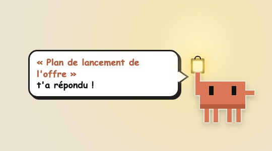
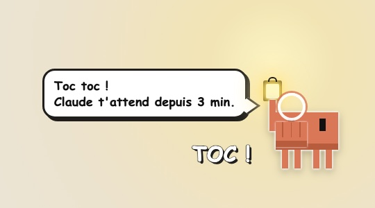

# Toc Toc 🔦

Tu lances une demande à Claude Code, puis tu pars sur YouTube en attendant. Claude a fini depuis longtemps, et tu ne t'en rends pas compte.

**Toc Toc** vient te chercher : quand Claude t'a répondu et que personne n'a touché l'ordinateur depuis **1 minute**, un mini Claude orange arrive sur le côté de l'écran, une lampe à la main. Il fait des signaux lumineux, te dit quelle conversation t'a répondu, puis **toque à la vitre** : l'écran tremble à chaque coup. Il le fait même par-dessus une vidéo en plein écran.

Dès que tu bouges la souris, il te fait coucou et repart. Il ne revient pas pour la même réponse.

<p align="center">
  
  
</p>

▶ **[Voir la démo dans ton navigateur](https://pablitooo5.github.io/toc-toc/demo.html)**

---

## Installer (Mac)

Ouvre l'app **Terminal** et colle cette ligne :

```bash
curl -fsSL https://raw.githubusercontent.com/Pablitooo5/toc-toc/main/install.sh | bash
```

Ensuite, clique sur l'icône **🔦** dans la barre des menus, puis sur **Lancer la démo**.

**Il te faut :** un Mac avec macOS 14 ou plus récent, **Claude Code** (onglet *Code* de l'app Claude, ou terminal), et les outils de développement d'Apple (`xcode-select --install` si l'installation te le demande).

## Ce qu'il fait, dans l'ordre

1. **Il arrive** sur le côté droit de l'écran, lampe à la main.
2. **Signaux lumineux** : court, court, long. Sa bulle donne le titre de la conversation qui t'a répondu (et combien d'autres attendent).
3. **Il toque à la vitre** : son poing vient vers toi, « TOC ! », et l'écran tremble. Un petit « toc » sonne à chaque coup.
4. **Au bout de 2 minutes**, il arrête de toquer : plus de coups, plus de son. Il reste là, et seule sa lampe clignote doucement.
5. **Tu bouges la souris** (ou tu tapes au clavier) : « Ah, te voilà ! 👋 », et il repart.

Il **ne vient pas** quand :
- tu utilises l'ordinateur (souris ou clavier dans la dernière minute) ;
- **le micro est allumé** : tu dictes à Claude, tu es en appel… (« Dis Siri », qui écoute en permanence, ne compte pas) ;
- l'écran est verrouillé ;
- il t'a déjà prévenu pour cette réponse.

## Le menu 🔦

- **Lancer la démo** (elle démarre 3 secondes après)
- **En pause** : il ne vient plus tant que c'est coché
- **Son (toc toc)** : activé par défaut
- **Venir après…** : 30 s, 1 min, 2 min ou 5 min sans toucher l'ordinateur
- **Faire vraiment trembler l'écran : autoriser…** : voir plus bas
- **Le renvoyer maintenant**

### Faire trembler tout l'écran

Pour que tout l'écran tremble, Toc Toc prend une photo de l'écran juste avant chaque série de coups et la fait vibrer. macOS demande ton accord pour ça : clique sur **Faire vraiment trembler l'écran : autoriser…**, puis active **TocToc** dans *Réglages Système → Confidentialité et sécurité → Enregistrement de l'écran*.

Sans cette autorisation, tout marche quand même : ce sont les bords de l'écran qui vibrent et s'illuminent à chaque coup. Les photos restent en mémoire, ne sont jamais enregistrées et ne quittent pas ton Mac.

## Comment ça marche

Des *hooks* Claude Code (`Stop` et `Notification`) notent quand une conversation attend ta réponse, et d'autres (`UserPromptSubmit`, `PreToolUse`, `PostToolUse`, `SessionEnd`) effacent la note quand Claude se remet au travail ou que la conversation se ferme. L'app regarde depuis combien de temps la souris et le clavier n'ont pas bougé, et si une app utilise le micro. Elle ne lit pas le son, donc aucune autorisation n'est demandée pour ça. Les clics traversent toujours le dessin.

Rien n'est envoyé sur Internet. Tout tient dans `~/.claude/toc-toc` et dans des hooks de `~/.claude/settings.json`. Une copie de tes réglages est gardée à côté (`settings.json.avant-toc-toc.bak`).

## Désinstaller

```bash
~/.claude/toc-toc/uninstall.sh
```

## À savoir

Projet perso et non officiel, sans lien avec Anthropic. « Claude » et « Claude Code » sont des marques d'Anthropic ; le personnage est un clin d'œil fait par un fan. Licence MIT.

Du même auteur :
- [Travail Terminé](https://github.com/Pablitooo5/travail-termine) : un mini personnage sort en bas à gauche avec une pancarte quand Claude finit une tâche.
- [Alerte Contexte](https://github.com/Pablitooo5/alerte-contexte) : un chef de chantier passe avec une pancarte quand ta conversation devient trop lourde.
- [Le Videur](https://github.com/Pablitooo5/le-videur) : un videur arrête Claude avant une action dangereuse et te demande ton accord.
